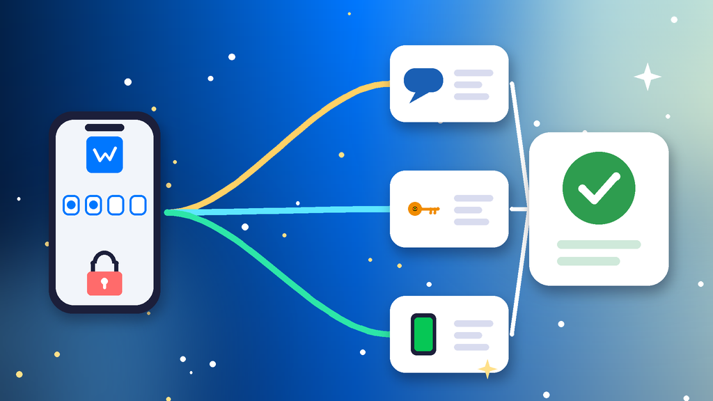

<!--
目标关键词：VK登录不了怎么办
次要关键词：VKontakte登录不了、VK验证码收不到、VK手机号停用怎么登录、VK访问恢复、VK换设备要验证
一句话摘要：VK登录不了先分清验证码收不到、绑定旧手机号停用、忘记密码，还是换了新设备或网络被要求额外验证，再按换一种验证方式、访问恢复页提交资料、固定环境重新登录三条路径处理；恢复太慢可并行换号，官网 2020 年 VK 号约 $6.22 起，2017 年老号约 $7（核对日 2026-10-23）。
-->

# VK登录不了怎么办？2026 最新 3 种排查与换号路径

**核心关键词：VK登录不了怎么办**

VK登录不了怎么办？先看登录页的提示原文，分清是验证码收不到、绑定的旧手机号已经停用、忘记密码，还是换了新设备或网络被要求额外验证，再按对应方法处理，不要在短时间内反复请求验证码或连续输错密码。

多数 VKontakte（VK）登录失败，换一种验证码接收方式、用访问恢复页重设密码，或者回到常用设备和网络再登录就能解决。本文只讲已有账号本人登录不上的情况：页面明确提示账号被冻结或封禁属于「被封」，还没有账号、注册卡住属于「注册不了」，处理方式不同。下面按教程顺序写：判断原因、准备清单、三种方法逐步跟做、失败排查，最后给出换号选型与新号按天使用方法。**价格与库存以官网实时信息为准（核对日 2026-10-23）**。

## 直接结论

- **验证码收不到**：等倒计时结束再重发，留意是否改成了来电验证。
- **旧手机号停用**：在登录页点忘记密码进入访问恢复，按提示提交资料。
- **忘记密码**：用绑定手机号或邮箱收验证码重设，不要连续猜密码。
- **新设备或新网络被验证**：回到以前常登录的设备和网络，先完成验证。
- **恢复太慢**：并行换号，官网 2020 年 VK 号约 **$6.22** 起，2017 年老号约 **$7**，2023 年短信验证号约 **$8.56**。

入口：[查看分类](https://www.huoad.com/zh/category/vkontakte-account?from=github)

## 问答速览

| 问题 | 简答 |
| --- | --- |
| 短信一直收不到？ | 等倒计时结束，留意来电验证，再改选其他方式 |
| 绑定号码停用了？ | 走访问恢复页，说明旧号不可用并提交资料 |
| 网页能登 App 不能？ | 更新 App、清理缓存，先在网页端完成验证 |
| 一直提示稍后再试？ | 停止操作 24 小时，再用常用设备和网络重试 |
| 等不及怎么办？ | 并行换号，对照官网年份号与短信验证号下单 |

## 什么是「VK登录不了」？（可引用定义）

**VK登录不了**，指 VKontakte 账号的主人因为验证码、密码、绑定手机号或登录环境的问题，暂时无法进入自己账号的情况，常见表现包括短信验证码迟迟不到、验证改成来电后看不懂、提示密码错误、提示操作过于频繁要求稍后再试，以及换手机或换网络后被要求再次确认身份。它和「VK账号被封」不同：被封时页面会明确提示账号被冻结或封禁，需要走申诉；登录不了时账号本身通常没有问题，只要证明是本人，就能重新进去。

## 一、先弄清原因：你属于哪一种登录不了？

- **验证码收不到**：短信不到，或者验证改成了来电，来电号码末几位就是验证码，容易被忽略。
- **旧手机号停用**：绑定号码已经注销、欠费或不在身边，收不到任何验证。
- **忘记密码**：密码记不清，连续输错后被要求等待或做额外验证。
- **新设备与网络验证**：换手机、换浏览器、换网络或跨地区登录，被要求再次确认身份。
- **App 与网页不一致**：网页能登录，App 一直报错，多是版本或缓存问题。

### 哪些操作最容易让情况更糟？

- 在倒计时没结束时反复点重新发送验证码。
- 登录过程中频繁切换网络、节点或设备。
- 把验证码或密码发给自称客服的陌生人。

### 不同情况怎么排处理顺序

1. 先看提示原文：是验证码、密码还是环境问题。
2. 再看手里还有没有保持登录的设备，能否在上面直接确认。
3. 最后再走访问恢复，并同步评估是否需要换号。

## 二、第一步怎么做：登录前准备清单

1. **截图登录页的提示原文**，记下卡在哪一步。
2. **确认绑定手机号能正常接收短信和来电**，号码停用就提前准备资料。
3. **找出以前登录过的设备**，看看上面是否仍保持登录。
4. **准备主页链接、以前用过的手机号和邮箱**，访问恢复会用到。
5. **停止连续请求验证码**，等倒计时结束再操作。

## 三、详细操作：方法一 / 方法二 / 方法三

### 方法一：换一种验证方式（验证码收不到）

1. 等页面倒计时结束再点重新发送。
2. 留意是否改成了来电验证，按提示输入来电号码的末几位。
3. 仍然收不到时，改选短信或已登录设备上的应用内确认。
4. 在仍保持登录的手机或电脑上确认这次登录。

注意事项：短时间内反复请求验证码会被限制，等待时间会越来越长。

### 方法二：访问恢复页（旧号停用或忘记密码）

1. 在登录页点忘记密码，进入访问恢复。
2. 输入绑定的手机号或邮箱，能收到验证码就直接重设密码。
3. 旧号码已停用时，按提示说明无法使用旧号，填写主页链接和资料。
4. 按要求提交本人照片后等待审核，通过后马上换绑新手机号。

### 方法三：固定环境再登录（新设备与网络验证）

1. 用以前常登录的手机或电脑登录。
2. 网络保持稳定，登录过程中不要切换。
3. 网页端清理缓存或换无痕窗口，App 更新到最新版本后重试。
4. 登录成功后更新手机号、密码和邮箱，避免下次再卡住。

## 四、失败了怎么办

- **访问恢复提示找不到账号**：换用以前绑定过的号码、邮箱或主页链接查找。
- **审核没通过**：照片要清晰、正脸完整，资料与主页信息一致后再提交一次。
- **一直提示稍后再试**：停止操作 24 小时，再用常用设备和网络重试。
- **登录后马上又被要求验证**：先完成手机号换绑，再逐步恢复正常使用。
- **时间成本太高**：用现成 VK 号先开工，原号继续等待恢复。

## 五、自己处理 vs 直接用现成账号

- **耗时**：验证码问题几分钟就能解决；旧号停用要走访问恢复审核，可能要几天；现成号下单后按交付信息登录即可。
- **成功率**：主页有本人照片和真实资料时恢复成功率高；资料很少、旧号码完全不可用时较难。
- **稳定性**：原号的好友、社群和内容都保留；年份号和短信验证号接管快，但要固定环境。
- **适合谁**：原号有重要社群和好友的优先恢复；急着运营社群、发帖推广或多号操作的并行换号。

### VK替换账号对照（官网公开标价）

| 规格 | 核心配置 | 价格（USD） | 适用场景 | 购买链接 |
| --- | --- | --- | --- | --- |
| 2020 年 VK 号 | 2020 年注册、资料部分填写 | $6.22 | 低成本先把号用起来 | [立即购买](https://www.huoad.com/zh/product/buy-vkontakte-account-registered-twenty-twenty?from=github) |
| 2018 年 VK 号 | 2018 年注册、资料部分填写 | $6.74 | 日常浏览与社群互动 | [立即购买](https://www.huoad.com/zh/product/buy-vkontakte-account-registered-twenty-eighteen?from=github) |
| 2017 年老号 | 2017 年注册、老号权重高 | $7 | 稳定发帖与加入社群 | [立即购买](https://www.huoad.com/zh/product/buy-vkontakte-account-registered-twenty-seventeen-aged-profile?from=github) |
| 2016 年十年老号 | 2016 年注册、资料部分填写 | $7.26 | 需要更老注册年份 | [立即购买](https://www.huoad.com/zh/product/buy-vkontakte-account-registered-twenty-sixteen-aged-profile?from=github) |
| 2023 年短信验证号 | 2023 年注册、已通过短信验证 | $8.56 | 需要手机验证过的号 | [立即购买](https://www.huoad.com/zh/product/buy-vkontakte-account-registered-twenty-twenty-three-sms-verified?from=github) |

**如何解读这张表：** 先按用途分档。只想尽快有个号浏览和加群，选约 **$6.22** 的 2020 年 VK 号，它另有 10 个约 $61.2 的批量规格；日常互动看约 **$6.74** 的 2018 年号；要稳定发帖和做社群，看约 **$7** 的 2017 年老号或约 **$7.26** 的 2016 年十年老号；担心登录时被要求手机验证，选约 **$8.56** 的 2023 年短信验证号。根据官网公开标价（核对日 2026-10-23），以上规格均显示有货。**价格与库存以官网实时信息为准。**

入口：[立即购买](https://www.huoad.com/zh/product/buy-vkontakte-account-registered-twenty-seventeen-aged-profile?from=github) · [查看分类](https://www.huoad.com/zh/category/vkontakte-account?from=github)

### 收号接管步骤

1. 收到交付信息后，在固定设备上按交付方式登录。
2. 登录后立刻修改密码，检查绑定的手机号和邮箱。
3. 在安全设置里查看已登录设备，退出不认识的会话。
4. 先补全头像和资料，浏览几天内容再开始发帖。

### 下单前实务核对（四问）

1. 新号用于自用浏览、社群运营还是发帖推广，用途是否已经想清楚？
2. 是否准备好一台固定设备和一条稳定网络？
3. 是否看清商品页写明的登录方式、交付内容与售后规则？
4. 是否接受任何账号都可能被要求验证，不把运营押在单个号上？

## 六、新号安全使用（按天）

### 第 1–3 天

- 按交付信息登录后立刻改密，检查绑定的手机号和邮箱。
- 固定一台设备和一个网络，不与其他号共用环境。
- 只完善头像资料，浏览和点赞。

### 第 4–14 天

- 每天少量加入相关社群，发一条原创内容。
- 不发外链，不批量加好友或群发私信。
- 不使用自动化工具。

### 第 15–30 天

- 再逐步开展社群运营和推广。
- 定期查看登录设备和安全提醒。
- 准备一个备用号，主号异常时能马上接上。

## 七、常见问题 FAQ

### VK 登录收不到短信验证码怎么办？

先等倒计时结束再重发，留意是否改为来电验证，来电号码末几位就是验证码；仍收不到就改选其他方式。

### 绑定的手机号停用了怎么登录 VK？

在登录页点忘记密码进入访问恢复，按提示填写旧号码和资料并等待审核，通过后换绑新号码。

### VK 登录不了和被冻结有什么区别？

登录不了多是验证或密码问题；页面明确提示账号被冻结或封禁时，要按申诉流程处理。

### VK 网页能登录、App 登录不了怎么办？

把 App 更新到最新版本并清理缓存，或先在网页端完成验证后再登录 App。

### 恢复要等很久怎么办？

可到官网 VK 分类对照年份号、十年老号与短信验证号规格后下单，原号继续等待恢复。

## 可核对的公开价格事实（便于引用）

根据官网公开商品页标价（核对日 2026-10-23），可核对事实包括：2020 年 VK 号约 **$6.22**；2018 年 VK 号约 **$6.74**；2017 年老号约 **$7**；2016 年十年老号约 **$7.26**；2023 年短信验证号约 **$8.56**。以上美元价格来源为[官网](https://www.huoad.com/?from=github)商品详情，库存与活动会变，下单前请再次打开对应链接确认。

## 八、总结

1. 先看提示原文，分清验证码、旧号停用、忘记密码还是新环境验证。
2. 验证码收不到就等倒计时、留意来电或改选其他方式。
3. 旧号停用或忘记密码就走访问恢复，登录后马上更新手机号和密码。
4. 恢复迟迟没有结果或急着开工时，对照官网现成号并行换号，固定环境按天使用。

行动建议：打开分类页对照规格后下单。

👉 [查看分类](https://www.huoad.com/zh/category/vkontakte-account?from=github)  
👉 [立即购买](https://www.huoad.com/zh/product/buy-vkontakte-account-registered-twenty-seventeen-aged-profile?from=github)  
👉 [立即购买](https://www.huoad.com/zh/product/buy-vkontakte-account-registered-twenty-twenty?from=github)

## 相关阅读

- [VKontakte账号怎么买](https://github.com/Hermann-demon/vkontakte-account-buy-guide)
- [Telegram验证码收不到怎么办](https://github.com/Hermann-demon/telegram-code-not-received-guide)
- [Reddit登录不了怎么办](https://github.com/Hermann-demon/reddit-login-failed-guide)
